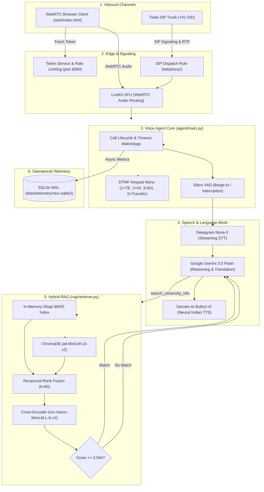

# Nexi: Multilingual Voice AI Assistant for Universities

A full-duplex, conversational voice AI assistant engineered for **SRM University-AP**. Nexi allows students, parents, and faculty to speak naturally—over a web browser or standard telephone line—and receive immediate, spoken answers grounded in official university policies.

---

[](https://www.python.org/)
[](https://livekit.io/)
[](https://ai.google.dev/)
[](https://www.sarvam.ai/)
[](https://deepgram.com/)
[](tests/)
[](tests/)
[](Dockerfile)

---

## Overview

Finding specific information in university handbooks, exam ordinances, fee structures, and hostel policies usually involves reading through dozens of circulars and dense PDFs.

Nexi replaces that search with a voice interface:
- **Sub-second response**: Conversational turnarounds average ~1 second from caller silence to the first audio byte.
- **Zero hallucinations**: Responses are strictly grounded in 11 official university policy documents (817 indexed chunks). If a query cannot be answered from verified documents, Nexi abstains and refers the caller to the admissions office.
- **Trilingual support**: Full conversational fluency in English, Telugu (`te`), and Hindi (`hi`), including mid-call language switching.
- **Web & Phone access**: Callers can connect via WebRTC in the browser or dial in directly via PSTN telephone numbers through Twilio SIP trunking.
- **Privacy-first**: No audio or conversational transcripts are stored. Operational metrics (latencies, turn counts, knowledge gaps) are logged asynchronously to a local SQLite database with masked caller IDs.

---

## Architecture



### Retrieval & Grounding Pipeline

1. **In-Memory Okapi BM25**: Pure-Python inverted index of 817 chunks for exact keywords (course codes, faculty names, acronyms). Runs in `<1 ms`.
2. **Dense Vector Search**: ChromaDB semantic search using `sentence-transformers/all-MiniLM-L6-v2`.
3. **Reciprocal Rank Fusion (RRF)**: Merges top candidates from BM25 and vector search ($k=60$).
4. **Cross-Encoder Reranking**: Evaluates top-16 candidates using `ms-marco-MiniLM-L-6-v2`. Candidates below the calibrated threshold (`score < 3.564`) are dropped.
5. **Deterministic Abstention**: If no chunk passes the threshold, the tool returns `NO_RESULTS`, directing the agent to politely decline rather than speculate.

---

## Tech Stack

| Component | Technology | Version / Model | Notes |
| :--- | :--- | :--- | :--- |
| **Runtime** | Python | 3.11 | Pure CPU execution, zero CUDA dependencies |
| **Voice Streaming** | LiveKit Agents | 1.2.6 / 1.4.3 | WebRTC transport, room sessions, barge-in |
| **LLM Reasoning** | Google Gemini | `gemini-3.5-flash` | Intent extraction, tool use, trilingual generation |
| **Speech-to-Text** | Deepgram | `nova-3` | Streaming WebSocket ASR (~120ms latency) |
| **Text-to-Speech** | Sarvam AI | `bulbul:v3` (`kavya`) | Natural Indian English, Telugu, and Hindi audio |
| **Voice Activity** | Silero VAD | v4 | In-stream voice detection for natural interruption |
| **Vector Database** | ChromaDB | Local | Persistent storage for document embeddings |
| **Reranker** | Sentence Transformers | `ms-marco-MiniLM-L-6-v2` | Cross-encoder for anti-hallucination gating |
| **Telephony** | Twilio Elastic SIP | RFC 3261 | Inbound calls, 8 kHz audio profile, SIP REFER transfer |
| **Telemetry** | SQLite | WAL mode | Non-blocking async queue for operational call logs |

---

## Quickstart

### 1. Prerequisites

- Python 3.11
- Linux, macOS, or Windows WSL2
- System tools for PDF document processing:
  ```bash
  # Ubuntu / Debian / WSL2
  sudo apt-get update && sudo apt-get install -y poppler-utils tesseract-ocr

  # macOS
  brew install poppler tesseract
  ```

### 2. Setup Virtual Environment

```bash
git clone https://github.com/YEsh-DEV/nexi-ntl.git
cd nexi-ntl

python3.11 -m venv .venv
source .venv/bin/activate

# Install from pinned CPU-only lockfile (zero CUDA bloat)
pip install uv
uv pip install -r requirements-cpu.lock

# Verify clean environment
python scripts/check_lock.py
```

### 3. Configure Environment Variables

```bash
cp .env.example .env.local
```

Fill in your provider credentials:

```ini
# LiveKit Cloud
LIVEKIT_URL="wss://your-project.livekit.cloud"
LIVEKIT_API_KEY="your_api_key"
LIVEKIT_API_SECRET="your_api_secret"
AGENT_NAME="nexi"

# AI Model APIs
GOOGLE_API_KEY="your_gemini_key"
DEEPGRAM_API_KEY="your_deepgram_key"
SARVAM_API_KEY="your_sarvam_key"
```

### 4. Build Knowledge Base

```bash
# Ingest university policy PDFs into Chroma and BM25 index
python -m rag.ingest --allow-empty-sources

# Calibrate the cross-encoder score threshold
python -m rag.calibrate

# Run offline grounding evaluation
python -m rag.eval
```

### 5. Run the Services

Start the services in separate terminal windows:

```bash
# 1. Token & Health API (serves Web console on http://localhost:8080)
python -m agent.token_service

# 2. Voice Agent Worker
python -m agent.main dev

# 3. Background Maintenance Loop (stale call cleanup & log retention)
python -m agent.maintenance run
```

Open `http://localhost:8080` in your browser, click **Start Call**, and speak with Nexi.

---

## Docker Deployment

Build and run all services with Docker Compose:

```bash
# Build multi-stage images
docker compose build

# Start services in the background
docker compose up -d
```

The Compose setup:
- Runs processes under a non-root user (`appuser`, UID 10001).
- Mounts a shared persistent volume `nexi-data` for ChromaDB and SQLite storage.
- Configures a `stop_grace_period: 700s` and `--drain-timeout 660`, ensuring active phone calls (up to 10 minutes) conclude without interruption during rolling updates.

---

## Project Structure

```text
nexi-ntl/
├── agent/                         # Voice assistant runtime
│   ├── assistant.py               # NexiAgent logic, tool calling & provider wiring
│   ├── config.py                  # Validated settings & environment registry
│   ├── language.py                # Phrase tables, DTMF keypad menu & language handover
│   ├── lifecycle.py               # Call lifecycle, duration limits & SIP transfers
│   ├── main.py                    # LiveKit entrypoint & worker wiring (< 150 lines)
│   ├── maintenance.py             # Periodic stale session reconcile & log retention
│   ├── storage.py                 # SQLite WAL telemetry store
│   └── token_service.py           # Ephemeral token issuance & healthcheck endpoints
├── rag/                           # Knowledge retrieval engine
│   ├── chunking.py                # Document section chunking & metadata tagging
│   ├── ingest.py                  # Offline ingestion pipeline (PDF/JSON -> BM25 + Chroma)
│   ├── retriever.py               # Hybrid search (BM25 + Dense + RRF + Cross-Encoder)
│   ├── calibrate.py               # Empirical threshold calibration tool
│   └── eval.py                    # Offline grounding & retrieval benchmark runner
├── telephony/                     # Carrier SIP integration
│   ├── dispatch_rule.json         # LiveKit SIP individual room dispatch rule
│   └── inbound_trunk.json         # Twilio Elastic SIP trunk template
├── scripts/                       # Operational & validation utilities
│   ├── check_lock.py              # Asserts zero GPU/CUDA dependencies in lockfile
│   ├── smoke_providers.py         # Provider connectivity smoke test
│   ├── capacity_sample.py         # Memory and CPU resource sampler
│   └── capacity_report.py         # Concurrency and latency capacity calculator
├── docs/runbooks/                 # 10 production operational runbooks
│   ├── start-stop.md              # Service lifecycle & rolling restart
│   ├── rotate-keys.md             # API key rotation without downtime
│   ├── database-recovery.md       # SQLite WAL contention & recovery
│   └── sip-troubleshooting.md     # Debugging Twilio SIP drops & DTMF
├── tests/                         # 163 unit and integration tests (100% pass)
├── Dockerfile                     # Multi-stage container build
├── docker-compose.yml             # Container orchestration
└── README.md                      # Project documentation
```

---

## Testing & Quality

All 163 tests execute offline without requiring live third-party API credentials:

```bash
# Run full test suite with coverage
.venv/bin/coverage run -m unittest discover -s tests -p "test_*.py"

# Enforce 80% line coverage gate
.venv/bin/coverage report --include="agent/*,rag/*" --fail-under=80

# Lint and check for silent exceptions (S110/S112)
.venv/bin/ruff check agent rag tests scripts

# Validate lockfile CPU-only purity
python scripts/check_lock.py
```

---

## Configuration

Core environment variables are configured in `.env` (refer to `.env.example`). Key options:
- `LIVEKIT_URL`, `LIVEKIT_API_KEY`, `LIVEKIT_API_SECRET`: LiveKit connection details.
- `GOOGLE_API_KEY`, `DEEPGRAM_API_KEY`, `SARVAM_API_KEY`: Model provider keys.
- `AGENT_NAME`: Named dispatch identifier (default: `nexi`).
- `MAX_CALL_SECONDS_WEB` / `MAX_CALL_SECONDS_PHONE`: Hard limits on call duration (300s web, 600s phone).
- `RERANK_MIN_SCORE`: Cross-encoder acceptance threshold (calibrated default: `3.564`).

<details>
<summary><b>Complete Configuration Reference (75 Variables)</b></summary>

<!-- SETTINGS_TABLE_START -->
| Environment Variable | Description | Default | Required |
|---|---|---|---|
| `ADMISSION_FAIL_OPEN` | Allow token issuance when LiveKit capacity check fails (dev only) | `false` | No |
| `AGENT_NAME` | Named dispatch agent identifier matching SIP rules and tokens | `nexi` | Yes |
| `ALLOWED_ORIGINS` | Comma-separated list of allowed CORS origin URLs | `http://localhost:8080,http://127.0.0.1:8080,http://localhost:3000,http://127.0.0.1:3000` | No |
| `ALLOW_AUTO_DISPATCH` | Allow running without named dispatch (development only) | `0` | No |
| `ALLOW_UNTESTED_PROVIDER_VERSIONS` | Bypass provider plugin version check (development only) | `0` | No |
| `ALLOW_UNVERIFIED_KNOWLEDGE` | Allow loading unverified knowledge index (development only) | `0` | No |
| `CALL_LOG_RETENTION_DAYS` | Retention window in days for call_logs table | `90` | No |
| `CALL_WARNING_LEAD_S` | Lead time in seconds to announce call duration expiration | `30.0` | No |
| `CHROMA_DIR` | Directory holding versioned Chroma knowledge artifacts | `data/knowledge` | No |
| `CONTEXT_MAX_CHARS` | Maximum character budget for retrieved context | `4000` | No |
| `DEEPGRAM_API_KEY` | Deepgram API key for English speech-to-text | *(empty)* | Yes |
| `DEFAULT_LANGUAGE` | Default spoken language ('en', 'te', 'hi') | `en` | No |
| `EMBED_MODEL` | Sentence Transformer model name | `sentence-transformers/all-MiniLM-L6-v2` | No |
| `EMBED_REVISION` | Pinned HuggingFace revision commit for embedding model | `1110a243fdf4706b3f48f1d95db1a4f5529b4d41` | No |
| `END_CALL_TOTAL_TIMEOUT_S` | Hard total timeout in seconds for complete teardown sequence | `25.0` | No |
| `ENVIRONMENT` | Environment tier ('development' or 'production') | `development` | No |
| `FAREWELL_TIMEOUT_S` | Timeout in seconds for speaking farewell message | `8.0` | No |
| `GOOGLE_API_KEY` | Google Gemini API key for LLM responses | *(empty)* | Yes |
| `HOST` | Bind host IP for Token and Health HTTP API | `127.0.0.1` | No |
| `IDLE_PROCESSES` | Pre-warmed idle worker processes | `1` | No |
| `IDLE_SILENCE_GRACE` | Seconds of silence after prompt before disconnecting call | `8.0` | No |
| `IDLE_SILENCE_TIMEOUT` | Seconds of silence before prompting caller for activity | `8.0` | No |
| `INFERENCE_THREADS` | CPU thread limit for local neural inference | `1` | No |
| `JSON_DIR` | Directory holding university structured JSON records | `data/json` | No |
| `KNOWLEDGE_GAP_RETENTION_DAYS` | Retention window in days for resolved knowledge gaps | `180` | No |
| `LANGUAGE_MENU_TIMEOUT_S` | Inbound phone language menu selection timeout in seconds | `8.0` | No |
| `LIVEKIT_API_KEY` | API Key for LiveKit server authentication | *(empty)* | Yes |
| `LIVEKIT_API_SECRET` | API Secret for LiveKit server authentication | *(empty)* | Yes |
| `LIVEKIT_URL` | LiveKit Cloud or self-hosted server URL (ws:// or wss://) | *(empty)* | Yes |
| `LLM_MODEL` | Google Gemini model name | `gemini-3.5-flash` | No |
| `LOG_LEVEL` | Logging verbosity (DEBUG, INFO, WARNING, ERROR) | `INFO` | No |
| `MAX_CALL_SECONDS_PHONE` | Hard maximum call duration for phone calls in seconds | `600.0` | No |
| `MAX_CALL_SECONDS_WEB` | Hard maximum call duration for web sessions in seconds | `300.0` | No |
| `MAX_CONCURRENT_CALLS` | Maximum concurrent active call sessions allowed | `5` | No |
| `MAX_LANGUAGE_SWITCHES` | Maximum allowed language switches per call | `5` | No |
| `MAX_TOKENS_PER_DAY` | Maximum tokens allowed to be issued per UTC day | `300` | No |
| `NEXI_ENV` | Alias for ENVIRONMENT | `development` | No |
| `NOISE_CANCELLATION` | Enable noise cancellation filter (BVC/BVCTelephony) | `false` | No |
| `PARTICIPANT_TIMEOUT` | Timeout in seconds waiting for participant to connect | `30.0` | No |
| `PDF_DIR` | Directory holding university source PDFs | `uni_pdfs` | No |
| `PHONE_SAMPLE_RATE` | Audio sample rate for telephony SIP callers in Hz | `8000` | No |
| `PII_EXTRA_PATTERNS` | JSON list of custom regex patterns to redact from questions | *(empty)* | No |
| `PII_HASH_KEY` | Secret key for HMAC-SHA256 caller number hashing (required in prod) | *(empty)* | No |
| `PORT` | Bind port for Token and Health HTTP API | `8080` | No |
| `PREWARM_TIMEOUT` | Timeout in seconds for prewarming models and index | `120.0` | No |
| `QUERY_MAX_CHARS` | Maximum character length of student query | `1000` | No |
| `REQUIRE_CAPTCHA` | Require captcha verification proof before token issuance | `false` | No |
| `RERANK_MIN_SCORE` | Relevance threshold for accepting reranked evidence | `0.0` | No |
| `RERANK_MODEL` | Cross-Encoder reranker model name | `cross-encoder/ms-marco-MiniLM-L-6-v2` | No |
| `RERANK_REVISION` | Pinned HuggingFace revision commit for reranker model | `233902d25c440f23af6f7d6e94d2946bac0bee0a` | No |
| `RETRIEVAL_K` | Candidate chunk count for dense and BM25 retrieval | `12` | No |
| `RETRIEVAL_TOP_N` | Final context chunk count passed to LLM | `4` | No |
| `ROOM_DELETE_TIMEOUT_S` | Timeout in seconds for LiveKit API delete_room request | `5.0` | No |
| `SARVAM_API_KEY` | Sarvam AI API key for Bulbul TTS and Indian language STT | *(empty)* | Yes |
| `SEARCH_TIMEOUT` | Timeout in seconds for retrieval queries | `6.0` | No |
| `SESSION_CLOSE_TIMEOUT_S` | Timeout in seconds for closing LiveKit AgentSession | `5.0` | No |
| `SHUTDOWN_TIMEOUT` | Timeout in seconds for process shutdown grace period | `10.0` | No |
| `SPEECH_TIMEOUT` | Timeout in seconds for TTS generation and playback | `15.0` | No |
| `STT_LANGUAGE` | Default STT language code for English | `en-US` | No |
| `STT_MODEL` | Deepgram STT model name | `nova-3` | No |
| `TELEMETRY_DRAIN_TIMEOUT_S` | Timeout in seconds to drain queued telemetry events | `5.0` | No |
| `TELEMETRY_QUEUE_SIZE` | Maximum in-memory bounded queue size for telemetry events | `1000` | No |
| `TELEMETRY_SPILL_PATH` | File path for critical event spillover when queue is saturated | *(empty)* | No |
| `TIMEZONE` | Campus IANA timezone for date/time prompts | `Asia/Kolkata` | No |
| `TOKEN_RATE_GLOBAL_PER_MIN` | Maximum global token generation requests per minute | `60` | No |
| `TOKEN_RATE_PER_IP` | Maximum token generation requests per client IP per window | `10` | No |
| `TOKEN_RATE_WINDOW_S` | Sliding rate limit window in seconds | `600.0` | No |
| `TOKEN_TTL_S` | TTL duration for issued LiveKit room tokens in seconds | `600.0` | No |
| `TRANSFER_GRACE_S` | Extra grace seconds allowed if transfer is active at duration limit | `15.0` | No |
| `TRANSFER_TARGETS` | JSON object mapping department names to allowlisted E.164 phone numbers | *(empty)* | No |
| `TRANSFER_TIMEOUT_S` | Timeout in seconds for SIP REFER transfer request | `10.0` | No |
| `TRUSTED_PROXIES` | Comma-separated list of trusted reverse proxy IP addresses | *(empty)* | No |
| `TTS_MODEL` | Sarvam TTS model name (e.g. bulbul:v3) | `bulbul:v3` | No |
| `TTS_SPEAKER` | Sarvam TTS speaker voice name | `kavya` | No |
| `TURN_METRICS_RETENTION_DAYS` | Retention window in days for stage_metrics table | `30` | No |
| `WEB_SAMPLE_RATE` | Audio sample rate for web clients in Hz | `24000` | No |
| `WORKER_HEALTH_URL` | URL to probe LiveKit agent worker health | `http://127.0.0.1:8081/healthz` | No |
<!-- SETTINGS_TABLE_END -->

</details>

---

## Operational Runbooks

Production operational guides are maintained in `docs/runbooks/`:
- [`start-stop.md`](docs/runbooks/start-stop.md): Service startup, graceful shutdown, drain verification.
- [`rotate-keys.md`](docs/runbooks/rotate-keys.md): Zero-downtime rotation of provider API keys.
- [`knowledge-update.md`](docs/runbooks/knowledge-update.md): Adding and indexing new policy documents.
- [`provider-outage.md`](docs/runbooks/provider-outage.md): Fallback procedures during external API outages.
- [`database-recovery.md`](docs/runbooks/database-recovery.md): Handling SQLite lock contention and database recovery.
- [`latency-triage.md`](docs/runbooks/latency-triage.md): Isolating bottlenecks in STT, LLM, or TTS stages.
- [`stuck-calls.md`](docs/runbooks/stuck-calls.md): Clearing orphaned sessions.
- [`sip-troubleshooting.md`](docs/runbooks/sip-troubleshooting.md): Debugging carrier SIP trunk registration and DTMF.
- [`capacity-test.md`](docs/runbooks/capacity-test.md): Load testing concurrency and resource usage.
- [`stt-eval.md`](docs/runbooks/stt-eval.md): Human audio evaluation and dialect listening protocol.

---

## Authors & Acknowledgments

- **Lead Architecture & Engineering:** [Atmakuri Yeshwanth](https://github.com/YEsh-DEV)
- **Institution:** SRM University-AP, Andhra Pradesh, India
- **Core Technologies:** [LiveKit](https://livekit.io/), [Google Gemini](https://ai.google.dev/), [Sarvam AI](https://www.sarvam.ai/), [Deepgram](https://deepgram.com/), [ChromaDB](https://www.trychroma.com/).

---
*Built with care for the students and faculty of SRM University-AP.*
