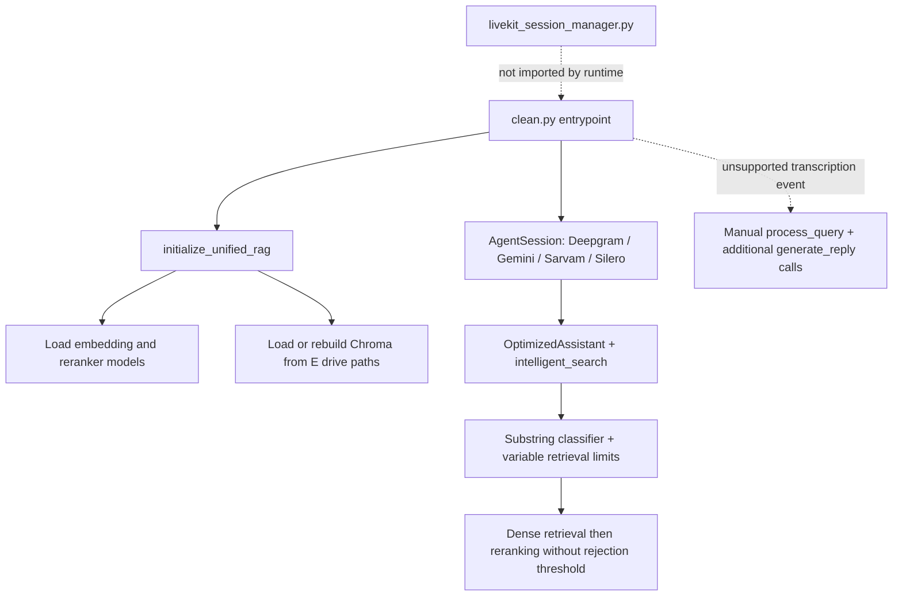
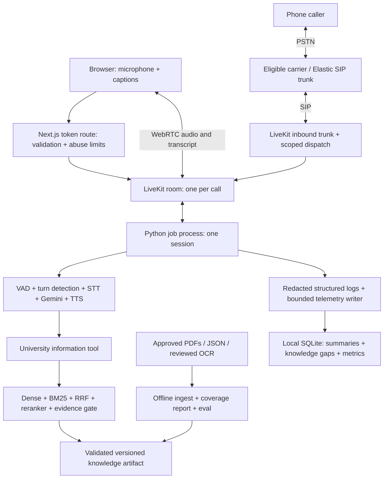
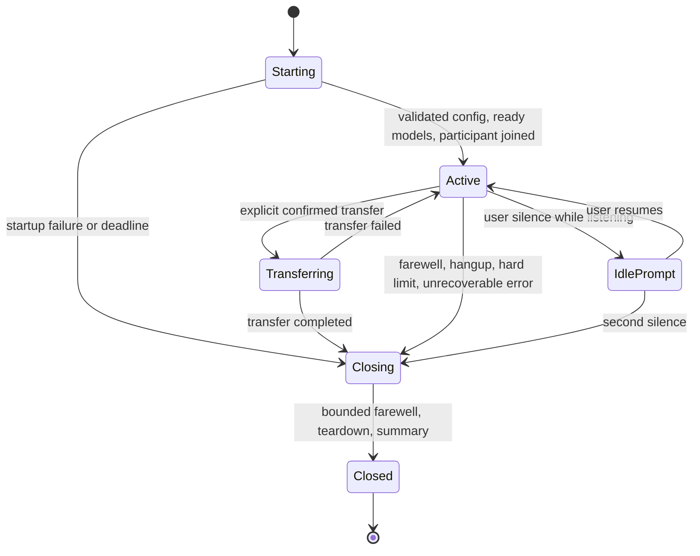

# Nexi: codebase assessment and implementation architecture through Phase 6

Review date: 2026-11-11. Status: proposed implementation baseline, not an implemented system.

This document interprets [Nexi — Implementation Playbook.md](Nexi%20%E2%80%94%20Implementation%20Playbook.md) against the actual repository. It covers preparation (Phase 0) and all work through Phase 6. It records corrections to the playbook rather than treating its example snippets as production code. Implementation should proceed one phase at a time, with evidence at each exit gate.

## 1. Scope and evidence

### What was inspected

- All five application modules, totaling 1,565 lines: `clean.py`, `rag_engine.py`, `tools.py`, `prompt_template.py`, and `livekit_session_manager.py`.
- All 1,064 lines of the playbook, including the later roadmap to identify scope boundaries.
- README, git ignore rules, dependency manifest, tracked-file inventory, and existing working-tree status.
- Selected source and distribution metadata in the existing Windows `.venv`, including LiveKit Agents 1.2.6 session, speech-handle, worker-options, event, and agent-context implementations.
- All eleven PDF files using read-only text extraction to assess ingestion suitability. This was an extraction audit, not a verification of every university fact or every PDF page.
- Current official documentation for important version-dependent architecture assumptions; references are listed below.

### Verification performed

All five Python files parse successfully with `ast.parse`. Isolated, in-memory executions of the existing pure JSON conversion methods reproduced dropped profile fields, skipped nested faculty, dropped event details, and fragmented fee records. These probes did not import application modules, load credentials, create a database, or call providers.

No full application execution, dependency installation, live call, provider credential validation, retrieval benchmark, or paid provisioning was performed. The existing environment has a Windows `Scripts/Lib` layout; it is not evidence of a working Linux runtime. API source inspection establishes some SDK contracts, but does not prove the entire dependency set works together.

Seven tracked files already appeared modified at review start; the playbook was already untracked. These changes must be preserved. This review adds only this architecture document. Secret values were not read or included. `.env` and `.env.local` are ignored and absent from the current tracked-file list; this is not a historical secret scan.

## 2. Product boundary

By Phase 6, Nexi should answer public SRM AP university questions over browser audio and inbound phone calls in English, Telugu, and Hindi, with source-grounded responses, graceful abstention, bounded cost, measurable quality, reproducible deployment, and documented capacity.

Included: voice lifecycle repair, offline PDF/JSON ingestion, hybrid retrieval, evaluation, inbound telephony, basic configured office transfer from playbook §5.4, multilingual selection and switching, web frontend, operational metrics, tests, CI, and Docker deployment.

Excluded: private student records, authenticated fee balances, complaint transactions, Spring Boot, MCP, A2A, admin portal, outbound campaigns, automated messaging, multi-tenancy, Kubernetes, and production migration to pgvector. Advanced human transfer with CRM/context delivery belongs to Phase 7; basic SIP transfer remains in Phase 3. Automatic language detection is an experimental Phase 4 capability behind a flag, not a prerequisite for reliable explicit selection.

Persistent memory across separate calls is not a Phase 6 requirement. Session history stays within one call. Aggregate call summaries do not provide conversation memory.

## 3. Current architecture and code quality



The prototype has useful separation between voice entrypoint, retrieval, tools, and prompt. It already uses a single knowledge tool, async wrappers around several blocking operations, source metadata, a reranker, and an explicit grounding instruction. These are useful foundations.

It is not currently production-ready. The largest problems concern runtime ownership, data correctness, reproducibility, and evidence of behavior, rather than formatting. The repeated “optimized” and “production” comments do not establish measured performance or reliability.

### Module responsibilities and disposition

| Current file | Actual responsibility | Planned disposition |
| --- | --- | --- |
| `clean.py` | Providers, room connection, assistant, extra conversation loop, background audio, health loop, cleanup | Split into `agent/main.py`, `assistant.py`, `providers.py`, `lifecycle.py`; retain only verified behavior |
| `rag_engine.py` | Config, models, database construction, PDF/JSON conversion, query retrieval, legacy adapter, print-based smoke checks | Split ingestion, chunking, manifest, and retrieval; use a transitional adapter in Phase 1 |
| `tools.py` | Tool wrapper, heuristic classifier, timeout and fallback, unused helpers | Move a thin tool wrapper into assistant; remove unused code after migration |
| `prompt_template.py` | Static English instructions | Replace with tested channel/language/date prompt builder |
| `livekit_session_manager.py` | Independent in-memory history and expiry manager | Remove after confirming no external consumer; do not migrate as persistence |
| `requirements.txt` | 188-line UTF-16 dependency snapshot | Preserve baseline evidence; produce deliberate direct dependencies and a resolved lock |
| `README.md` | Describes an older LlamaIndex/Groq/Cartesia implementation | Rewrite alongside working phases to describe observed behavior |

### Findings ranked by impact

“Confirmed” below means visible in code or reproduced with the limited checks above. A runtime consequence remains unmeasured unless explicitly stated.

| ID | Priority | Evidence | Finding and consequence | Resolution |
| --- | --- | --- | --- | --- |
| F01 | High | `clean.py:352`; local SDK `voice/events.py` | `transcription` is not a declared session event; active custom handler cannot be relied upon. If manually activated, it competes with the framework's normal reply path. Duplicate replies were not demonstrated in a live call. | Phase 1: remove custom reply orchestration; subscribe to supported events only for observation |
| F02 | High | `clean.py:110`, `:129`; SDK `agent_session.py:700`, `speech_handle.py:141` | `generate_reply` yields a SpeechHandle, and awaiting it waits for playout; string checks reject successful handles. Fallback strings returned by `process_query` are ignored by its caller. | Phase 1: framework-owned response path, explicit fixed greeting and bounded error handling |
| F03 | High | `clean.py:225`; `rag_engine.py:52`, `:163` | Call initialization may load models and build storage. Embedding construction blocks inside async initialization. In-process lock does not serialize different job processes. | Phase 1: offline bootstrap and prewarm; Phase 2: formal ingestion |
| F04 | High | `rag_engine.py:117`, `:188` | Timestamp-based rebuild does not identify deletions or model changes. No deterministic IDs or replacement operation prevents append-style duplicate/stale chunks. | Versioned index builds and manifest checks |
| F05 | High | `rag_engine.py:413` | Reranker ranks but never rejects; even a single irrelevant candidate can be returned. | Calibrated acceptance gate, including single-candidate and reranker-failure cases |
| F06 | High | `rag_engine.py:278`–`:384`; pure probes | Parent classification skips children; profile contacts/bio and event end dates/descriptions disappear; scalar fee fields lose record cohesion. | Record-oriented traversal with provenance |
| F07 | High | `rag_engine.py:25`; repository inventory | Hardcoded `E:/` locations do not point at checked-in `uni_pdfs`; JSON source corpus is absent. | Portable configuration and explicit corpus inventory |
| F08 | High | Imports `clean.py:17`; decoded requirements | Google and Sarvam LiveKit plugins are imported but not declared in requirements. Old provider dependencies remain. | Clean compatible dependency matrix and install/import checks |
| F09 | High | PDF extraction audit | Five PDFs yielded only page separators, including ordinances and conduct policy. A successful database build could still omit critical knowledge. | OCR/replacement workflow and source coverage gate |
| F10 | High | Calendar/exam filenames and extracted titles | Calendar AY 2025–26, May 2025 exams, and handbook 2024 cannot automatically establish current facts in November 2026. | Effective-date metadata, source owner review, and abstention for unsupported current facts |
| F11 | Medium | `clean.py:390`, `:414` | Polling health loop and cleanup probing omit `aclose`; background cleanup contains no close operation. | Supported shutdown callbacks, tracked tasks, idempotent cleanup |
| F12 | Medium | `clean.py:315`, `:436` | Signature filtering hides unsupported configuration instead of surfacing errors. The three requested retry/join fields are absent from inspected WorkerOptions. | Pin supported API and validate explicitly |
| F13 | Medium | `clean.py:90`, `:165` | Manual thinking methods are not present in inspected background player; exceptions hide misuse. | Remove initially; optional supported background sound after latency baseline |
| F14 | Medium | `tools.py:110`, `:145` | ToolError is caught and replaced; no-result and infrastructure errors become confused. Fallback can add six seconds after the first attempt. | Typed internal outcome and one bounded retrieval budget |
| F15 | Medium | `tools.py:20`, `:162`, `:203` | Substring classifier misclassifies ordinary words; helper functions and SearchMetrics have no runtime callers. | Fixed retrieval defaults and measured tuning |
| F16 | Medium | `clean.py:81`, `:361`; `tools.py:142`; `rag_engine.py:466` | Raw query fragments/full queries and participant identities enter logs. | Redaction and structured event fields |
| F17 | Medium | `rag_engine.py:443`; prompt | Arbitrary character truncation can remove qualifiers; prompt-only grounding is not a guarantee. No current date, evidence freshness, or conflict policy. | Whole-chunk packing, provenance, date-aware prompt and behavioral evaluation |
| F18 | Medium | `livekit_session_manager.py:224`; import graph; README | Unused session manager is memory-only, not archived persistent memory. Print-based “tests” have no assertions; some failures are swallowed. | Framework session context; real regression tests; accurate README |
| F19 | Medium | `clean.py:263` | Lowercase environment key is explicitly read. It can work if supplied, but conflicts with proposed uppercase configuration and provider conventions. | Canonical uppercase key; migration message without printing values |
| F20 | Medium | Repository inventory | No test suite, CI, frontend, deployment manifests, evaluated corpus, or capacity report. | Establish tests with each phase; integrate complete operational gates in Phase 6 |

### Knowledge-source audit

Text extraction here used `pdftotext`, not the future PyPDF/OCR pipeline. Zero text is evidence requiring investigation, not proof that every parser fails. Mixed image/text documents also need page-level checks.

| Source | Pages from extraction | Substantive extracted text | Required action |
| --- | ---: | --- | --- |
| Student Internship Policy | 4 | None | OCR or accessible authoritative replacement |
| Financial Assistance Policy | 7 | None | OCR or replacement |
| Seed Grant Assistance Policy | 5 | None | OCR or replacement |
| Academic-Programmes-Ordinances | 51 | None | OCR or replacement |
| Student code of conduct | 26 | None | OCR or replacement |
| Academic Calendar AY 2025–26 | 15 | Present | Check table layout and effective year |
| Hostel Policy | 6 | Present | Check authoritative version |
| Endterm instructions May 2025 | 3 | Present | Historical scope only unless updated |
| Attendance Policy | 2 | Present, extraction artifacts | Review numeric rules and text quality |
| Student handbook | 47 | Present | Check mixed pages, 2024 edition, conflicts |
| UGC proforma with appendix | 188 | Present | Check age, tables, and relevance of administrative records |

Do not invent JSON data to claim coverage. Use synthetic JSON fixtures for chunker tests, and add actual approved university records only when supplied or sourced and reviewed. Do not promise that existing PDFs cover faculty contacts, current fees, transport, or mess timings until evidence is located.

## 4. Playbook corrections and implementation decisions

| Playbook assumption | Decision for implementation |
| --- | --- |
| Free Twilio trial supports Elastic SIP trunk setup | Current Twilio limits page says SIP trunking is available after upgrading. Phase 3 has an account eligibility/budget prerequisite; no free-trial trunk promise. See reference R1. |
| Delete the active Chroma directory before rebuilding | Build a new version, validate it, then activate it. Preserve last known-good data and rollback. Never recursively delete an arbitrary configured path. |
| Phase 1 wraps existing retriever while all ingestion moves in Phase 2 | Phase 1 must already separate an offline bootstrap from read-only runtime opening; otherwise Phase 1's no-ingestion-in-call gate is impossible. Phase 2 replaces the bootstrap with complete ingestion. |
| Phase 1 fixes all 29 issues | Issue 29 is explicitly Phase 2 chunking work. Track all IDs, but mark that dependency pending rather than falsely completing it in Phase 1. |
| Handoff automatically keeps conversation history | Explicitly pass validated prior chat context and retain call userdata; current official docs say new agents start with fresh history by default. Verify on the selected SDK. R2. |
| All phone TTS must be 8 kHz | Select a supported model/output rate and verify negotiated audio/resampling end to end. Start with the playbook's narrowband profile where appropriate; do not treat every audio failure as a rate issue. R3. |
| Prewarm means one model copy for the whole server | Models belong to job processes; idle processes also consume RAM. Account for each warm process when sizing. R4. |
| `asyncio.wait_for(to_thread(...))` stops work | It stops waiting, not the running thread. Bound executor work and keep capacity occupied until the underlying task finishes. |
| New chunker drops chunks shorter than 40 characters | Never silently discard meaningful short facts. Preserve them or merge only within the same record with provenance. |
| Merge tiny sibling records | Avoid merging independent people, programs, or dated fees. Size targets are soft; semantic boundaries take precedence. |
| Keyword hit rate establishes retrieval quality | Retain it for comparison, but require expected source/record evidence and correctness checks. Shared words are insufficient. |
| Date injection answers “next holiday” | It supplies temporal context, not current knowledge or chronological retrieval. Use dated records/filtering and current source coverage; otherwise ask for year or abstain. |
| Phase 4 tests web language selector before Phase 5 | Use a minimal test harness/metadata dispatch in Phase 4. Product selector ships in Phase 5; do not claim the product UI exists early. |
| Plain context means source information is discarded | Keep structured evidence internally and optional web evidence separately. Keep spoken responses short without filenames. |
| `python main.py` from root | Standardize module execution from repository root: `python -m agent.main ...`, with package-qualified imports and package files. |
| Shutdown alone ends the phone call | Test both job shutdown and SIP participant/room teardown; leaving the PSTN leg connected can continue billing. |
| “Thanks” always ends a call | Require unambiguous farewell intent. “Thanks, and what about hostel fees?” must continue. |

## 5. Proposed system architecture

Use a modular Python application with local retrieval and a separate Next.js frontend/token service. Keep the latency-critical path short. No new network service is needed for retrieval at this stage.



### Proposed repository layout

```text
agent/
  __init__.py
  main.py                 # CLI/server wrapper, prewarm, entrypoint
  assistant.py            # knowledge and supported call-control tools
  config.py               # explicit validated settings loader
  providers.py            # pinned provider constructors and language profiles
  prompts.py              # channel/language/date prompt and fixed greetings
  lifecycle.py            # call context, timers, shutdown, language handoff
rag/
  __init__.py
  contracts.py            # retrieval/evidence outcomes
  chunking.py             # PDF and recursive JSON normalization
  ingest.py               # offline build/validate/publish
  manifest.py             # compatibility and artifact validation
  retriever.py            # dense/BM25/RRF/rerank/filter/pack
observability/
  __init__.py
  logging.py              # redaction and structured events
  store.py                # bounded durable summary/gap writes
  migrations/             # versioned SQLite schema
scripts/
  setup_sip.py             # inspect/plan/apply supported SIP configuration
  eval.py                  # retrieval and translation-aware evaluation
  capacity.py              # bounded concurrency scenario runner
eval/
  questions.yaml
  fixtures/                # synthetic/approved small corpus
  reports/                 # reproducible evidence, no private transcripts
tests/
  unit/
  integration/
  scenarios/
frontend/                  # Phase 5 Next.js application
data/
  pdfs/
  json/
  knowledge/<version>/     # generated immutable-by-policy artifacts
  telemetry/               # writable local state, ignored by git
docs/                      # phase evidence and operational runbooks
.env.example
requirements.txt
requirements.lock
Dockerfile
compose.yaml
.github/workflows/ci.yml
```

Layout is a target, not permission to create every placeholder immediately. Add modules as phases need them. Maintain only one active entrypoint after migration; a temporary compatibility launcher may delegate to it.

### Ownership and invariants

1. One framework session owns turn detection, speech generation, interruptions, and per-call history. Transcript callbacks never generate ordinary answers.
2. Each call has an opaque random `call_id`; participant identity/phone number is not authentication.
3. Call context owns channel, language, start time, deadline, knowledge version, prompt version, counters, and terminal reason. Mutable context is never shared across callers.
4. Prewarm loads only an already validated artifact and models. Missing/incompatible index means not ready, not automatic rebuilding.
5. The ingestion process is the only knowledge writer. Runtime performs no logical collection mutations; test whether selected embedded Chroma requires writable runtime files even while logically read-only.
6. All candidate records passed to answer generation retain provenance internally. Documents and tool content are untrusted data, never higher-priority instructions.
7. No personal-data tools exist through Phase 6. An anonymous caller receives only approved public facts.
8. Each graceful call close produces one idempotent summary. Abrupt process death is separately detected/reconciled; shutdown callbacks cannot guarantee execution after a kill.

## 6. Interfaces and configuration

### Configuration

Use an explicit `load_settings()` at startup rather than environment reads embedded as dataclass defaults at import time. Load `.env.local` only for local development. Environment variables override local defaults; production reads injected secrets. Validate enums, positive durations, bounded sizes, and required provider keys without printing them.

Configuration groups:

- Connection: LiveKit URL, API credentials, agent name, deployment environment.
- Providers: STT/LLM/TTS model IDs, supported voices, per-language settings, audio rates, provider timeouts.
- Knowledge: repository-relative or absolute PDF/JSON/artifact roots; active knowledge version; model revisions; retrieval limits and calibrated threshold profile.
- Lifecycle: call duration, silence grace/retry, participant wait, drain timeout, maximum tool calls per turn.
- Operations: local timezone `Asia/Kolkata`, log level, telemetry path, retention, concurrency limits, feature flags.
- Frontend/server: public LiveKit endpoint, configured phone fallback, token TTL, allowed origins, abuse controls. No secret uses a public frontend environment prefix.

Validate metadata as an object with allowed `channel in {web, phone}` and `language in {en, te, hi}`. Handle malformed JSON, arrays, null, unknown values, and oversize metadata. Derive channel from trusted dispatch and observed SIP participant type; do not let browser metadata activate phone-only capabilities.

### Retrieval interface

Internally return a typed outcome instead of an ambiguous empty string:

```text
SearchRequest(query, language, as_of_date, call_id, deadline)
SearchResult(
  status = FOUND | NO_RESULTS | TIMEOUT | UNAVAILABLE | INVALID_QUERY,
  evidence = [Evidence(chunk_id, source_id, page_or_path, text, score, effective_dates)],
  knowledge_version,
  timings,
  failure_code?
)
```

The LLM tool maps `FOUND` to bounded evidence text and `NO_RESULTS` to the playbook's sentinel. Infrastructure failures produce a controlled temporary-failure response, not “the university has no information.” Internal metadata does not need to consume prompt tokens. Cap query length and tool invocations; reject unsupported inputs deterministically.

### Frontend token contract

`POST /api/token` accepts a validated language and any required anti-abuse proof. The server generates a random room and participant identity, authorizes only that room, and requests the configured named agent. It returns `{token, url, room, expires_at}` with no-store caching headers.

Expected failures: 400 invalid input, 429 rate limit, 503 capacity/provider unavailable. Do not expose stack traces. Browser token lifetime does not enforce connected-call duration: enforce duration in the worker and verify room/SIP teardown.

## 7. Knowledge pipeline and retrieval correctness

### Ingestion sequence

1. Enumerate approved sources in deterministic order. Compute content hashes and record ownership, source version, effective date range, and parser status.
2. Detect unreadable PDFs, empty/low-text pages, malformed JSON, duplicate sources, and unsupported file sizes. Quarantine failures in a report. Fail publication if required sources are missing; optional omissions require an explicit recorded coverage exception.
3. For scanned content, perform offline OCR or use an accessible authoritative replacement. Retain page mapping and original source hash. Manually verify critical amounts, percentages, dates, and policy exceptions. OCR is not proof of correctness.
4. Normalize into coherent records/chunks. Preserve JSON scalar fields, nested paths, record identity, list values, booleans and zero values. Test root scalars, nulls, repeated names, long fields, and nested records.
5. Preserve semantic parent labels for nested children, such as course name and academic year. A path of numeric indices alone is insufficient. Avoid unrelated-record merging.
6. For PDFs preserve one-based displayed page number, original page index, source title, and headings where reliably extractable. Keep table rows/headers together where needed; flag ambiguous table extraction for review.
7. Assign deterministic chunk IDs using source identity/content version, structural path or page/span, and normalized text. Record splitter and embedding model revisions.
8. Build a separate version directory/collection with Chroma and a BM25-ready corpus from the same chunk IDs. Write manifest with per-source counts, failures, hashes, model/dimension/normalization, build version, schema version, and timestamp.
9. Validate counts, compatibility, sample retrieval, and evaluation. Only then publish the new artifact reference. Stop/drain workers for the initial deployment; avoid live in-place index modification.
10. Retain the previous validated artifact. Repeating the same build must yield identical IDs/counts; updating/removing a source must not retain stale chunks in the newly activated version.

A failed build leaves the active artifact untouched. The agent verifies the manifest/model fingerprint, not merely that a folder exists. Chroma and BM25 must refer to the same knowledge version.

### Retrieval stages

- Start from the playbook's candidate sizes: dense top 12, BM25 top 12, RRF merge to at most 16, cross-encoder rerank, return up to 4 evidence chunks.
- Fuse using stable chunk IDs, not text alone; retain all provenance when content is duplicated. Define stable tie-breaking and deduplicate within each result list.
- Use `1 / (60 + rank)` with one-based ranks. Raw reranker scores are not confidence percentages. Calibrate thresholds on labeled development examples; evaluate on a separate held-out set.
- Apply acceptance to every result path, including one candidate. If reranking fails, fail safely unless an independently calibrated dense-only fallback exists.
- Pack whole facts/chunks within a prompt budget. Do not cut a date, negation, fee condition, or exception in the middle. Repeated headings should not consume most of the budget.
- Treat conflicting editions and missing effective dates explicitly. Do not silently choose an apparently relevant older calendar to answer a current question.
- For “next” and date-range questions, use structured dated records with deterministic date filtering where available. Retrieve event meaning after filtering; ask for clarification if year/program is missing.

### Grounding and injection defenses

The prompt mandates retrieval for university facts, but this alone cannot guarantee compliance. Add behavioral scenarios for missed tool calls, out-of-domain prompts, instructions embedded in retrieved documents, malicious requests to expose keys, and fabricated fee/date claims. Record whether a factual response had accepted supporting evidence. Before public release, enforce a supported framework policy/hook for the university-answer path if scenario tests show tool bypass; do not recreate a second conversation loop.

Clarifying questions and greetings do not need a knowledge lookup. Low confidence should lead to clarification or abstention. A failed provider is not a knowledge gap.

## 8. Voice lifecycle, telephony, and languages

### Lifecycle



Use monotonic clocks for elapsed durations and UTC for stored timestamps. Build prompts with the university-local date. Inactivity is measured while waiting for the user, excluding agent speech, tool execution, language menus, and transfer. Start with the playbook's approximate eight-second phone silence prompt and validate it with users.

Cancel and await tracked timers/tasks on closure. Suppress duplicate farewell/close actions. Do not recursively attempt speech indefinitely when TTS is failing. Browser can show a text error; phone may need to terminate cleanly without successful audio.

Bound thread-pool work and queueing. On timeout, detach the caller from the result but retain the executor slot until computation ends. Limit CPU inference threads to avoid multiplying CPU usage across job processes. Prewarm timeout must accommodate measured model/index loading; the inspected old SDK defaults to ten seconds, which must not be assumed adequate.

### Telephony

- Use a separate inbound trunk and individual-room dispatch scoped to its specific trunk ID from the beginning.
- Keep named dispatch consistent for phone and web after Phase 3. Provide a development dispatch helper rather than repeatedly changing production agent naming.
- Provisioning script supports inspect/plan/apply behavior and detects existing resources. Re-running must not create duplicate trunks/rules. Never publish credentials in JSON artifacts.
- Confirm account eligibility, number availability, provider security settings, regional routing, and actual rates before provisioning. The plan does not purchase a number or upgrade an account.
- Wait for the correct SIP participant before greeting; console mode bypasses room-participant waits.
- Caller number is optional sensitive metadata, not identity proof. Prefer not storing it; if correlation is needed use keyed HMAC rather than an unsalted hash of a guessable phone number.
- Basic transfer accepts an allowlisted office identifier, never an arbitrary LLM-provided destination. Confirm the caller's intent, verify provider REFER support, handle transfer failure, and verify the original job closes without dropping a failed transfer prematurely.
- Initial phase exit requires inbound calls, hangup, silence, farewell, maximum duration, and transfer success/failure scenarios. If an office destination or eligible carrier is absent, report the relevant live scenario as pending, not passed.

### Languages

Default to explicit selection. Web passes a validated language; phone offers speech/DTMF selection with a bounded timeout and English fallback. DTMF and speech events must be bound to the intended caller and serialized so duplicate selection events cannot create multiple handoffs.

Use one consistent switch mechanism: a new language-configured agent with explicitly transferred chat context and shared call userdata. No second greeting, reset call timer, or lost counters. Serialize switching against active turns. Validate current SDK support for STT/TTS overrides and context transfer before coding the abstraction.

Start with English search phrases generated from Telugu/Hindi questions while preserving names, numeric values, and course codes. The full multilingual evaluation must include this translation step; directly sending Telugu into an English embedding model does not test the intended system. Keep translated queries only when permitted by the telemetry policy. Translation should not invent missing entities.

Choose provider model/voice/rate combinations from the pinned plugin and provider catalog, not the playbook's placeholders. Compare English STT alternatives using the same recordings. Test at least ten code-mixed utterances and explicit mid-call switches. Auto-detection stays disabled by default until evidence supports it.

## 9. Web frontend and abuse controls

Implement the playbook's landing page, AI/privacy notice, language selector, suggested questions, phone fallback, audio visualizer, state labels, mute/end controls, both sides of captions, follow-up suggestions, responsive light/dark themes, and Telugu/Devanagari fonts.

Define suggestions clearly: pre-call chips may display examples; in-call chips submit text through the same session path once. Prevent a chip and transcript callback from both triggering a response. The UI must reflect connecting, waiting for agent, listening, thinking, speaking, reconnecting, and ended/error states without claiming a call is live too early.

Test denied microphone, missing device, autoplay restrictions, unavailable worker after roughly ten seconds, token errors, network loss, rate limit, server busy, and repeated start/end clicks. Release microphone tracks and subscriptions on unmount/end. Do not persist captions in browser storage by default. Use keyboard-operable controls, visible focus, readable contrast, and restrained live-region announcements.

The token route is a cost boundary. Rate limits must work across frontend instances; an in-memory counter in a serverless route is insufficient. Prefer host-managed distributed abuse controls initially. Also cap sessions/duration and provider budgets; per-IP limits alone penalize shared campus networks and do not stop distributed abuse. Add server-verified captcha when publicly exposed. Validate origin and trusted proxy headers; client IP headers are not inherently trustworthy.

Phone fallback is shown only when a real working number is configured. Never publish a placeholder as if operational.

## 10. Observability, privacy, and operational storage

Implement essential structured logs and metrics from Phase 1; Phase 6 completes storage, reports, alerts, and release evidence.

### Proposed records

| Record | Important fields and constraints |
| --- | --- |
| `call_logs` | `call_id` primary key; started/ended UTC; initial/final language; channel; status; terminal reason; duration; turns; tool calls; no-result/timeouts/errors; provider usage; app/prompt/knowledge versions |
| `turn_metrics` | Unique `(call_id, turn_id, stage, sequence)`; duration; outcome; model; timestamp. No query text. |
| `knowledge_gaps` | Unique event ID; call/turn IDs; redacted question if safe; language; category; knowledge version; first/last seen; review state |
| `schema_migrations` | Applied schema version and timestamp |

Use SQLite on a local filesystem for the initial single-host deployment, with short transactions, busy timeout, tested WAL behavior, and idempotent inserts/upserts. Writes run outside the audio event loop through a bounded queue/executor. Never hold a database transaction during a provider request. Keep generated telemetry out of git and container images.

Persist a minimal started-call row, update at closure, and mark stale unfinished calls as incomplete after restart reconciliation. Shutdown callbacks alone cannot guarantee a summary after abrupt death. Bounded retries and a protected local failure spool should make write failures visible; telemetry failures must not block audio indefinitely. Load-test concurrent writers. Do not share this SQLite file across multiple hosts/network filesystems; choose a central store before multi-host deployment.

Log dimensions: call ID, turn ID, stage, channel, language, outcome, versions, duration, error code. Do not log tokens, credentials, full phone numbers, unrestricted provider payloads, or full transcripts. Call IDs belong in logs/traces, not high-cardinality metric labels.

Knowledge gaps distinguish missing evidence from timeout/provider outage. Redact question content before persistence; discard unsafe free text when redaction is uncertain and retain only category/count. Proposed starting retention: 30 days for redacted operational/gap detail, with aggregated statistics retained longer if useful. This is a product-policy proposal requiring owner agreement before public release, not a legal retention claim. Audio recording stays off by default; demo recordings require explicit participant permission and redaction before sharing.

## 11. Metrics and quality gates

Numbers below are acceptance proposals or playbook targets, not measured results. Record machine, region, corpus version, model revision, sample count, warm/cold state, and concurrency with every benchmark.

| Metric | Definition | Initial gate |
| --- | --- | --- |
| Evidence hit@4 | Answerable held-out questions with expected supporting record in accepted top four | At least 85%, retaining playbook target but using evidence labels |
| Off-topic refusal | Off-topic cases with no unsupported university answer | 100% on the finite test set; not a universal guarantee |
| In-domain unanswerable refusal | Missing/stale/conflicting information cases handled safely | Report separately; no unsupported critical fee/date claim in release scenarios |
| False refusal | Answerable questions rejected | Report count/rate alongside recall; avoid gaming refusal by rejecting everything |
| Retrieval p50/p95 | Query submission through accepted evidence or terminal failure | p95 below 800 ms warm on declared baseline hardware, as in playbook |
| End-of-turn response latency | End of user speech to first audible answer, excluding thinking sound | Proposed warm p95 <= 3 seconds; establish and revisit after Phase 1 measurements |
| First greeting delay | Participant ready to first audible greeting | Proposed <= 5 seconds for controlled tests; report phone dial-to-greeting separately |
| Stage latency | Endpointing delay, STT finalization, LLM TTFT, tool time, TTS TTFB | p50/p95 by channel/language; never sum independent stage p95 values as end-to-end p95 |
| Interruption behavior | User interruption to agent audio stop, with context continuing correctly | No duplicate answer; measure delay before selecting numerical gate |
| Grounding | Claims supported by accepted source and effective date | Human-reviewed critical-fact scenarios pass; tool-call compliance measured |
| Language quality | Selection accuracy, entity preservation, STT WER/CER, TTS intelligibility | Per-language results; no language-selection failures in deterministic test cases |
| Isolation/lifecycle | Cross-call data leakage, duplicate replies, orphan phone legs | Zero in tested scenarios |
| Summary completeness | Terminal/incomplete call records relative to started calls | All graceful test calls one final summary; killed calls visible as incomplete |
| Capacity | CPU, RSS, queue depth, errors, p95 at 1/5/10 calls | Publish largest tested load meeting gates; do not claim ten calls in advance |
| Cost | Provider token/audio/telephony usage per call and per minute | Track estimates with dated rate source; owner sets spend cap before public launch |

### Evaluation design

Start with 40–60 approved English examples, approximately 30 answerable, 10 unanswerable/off-topic, and 5 tricky/multi-part cases. Label expected source/record/page, required facts, forbidden claims, effective date, category, and answerability. Separate threshold-tuning and held-out cases, including paraphrases without leaking identical examples between sets.

Include exact names, abbreviations, numeric conditions, conflicting documents, old calendars, no evidence, adversarial document text, and multi-part questions where only one part is answerable. Keyword checks remain a secondary diagnostic. Record sample denominators; report metrics by category so a large easy category cannot hide failures.

Phase 4 adds 20 Telugu, 20 Hindi, and 10 code-mixed questions. Test translation/entity preservation independently, then end-to-end translated retrieval. Record 20 utterances per language with consent and listen to ten synthesized answers per language. Report uncertainty from small sample sizes rather than claiming universal language accuracy.

CI uses offline fixtures and deterministic tests with pinned model artifacts; real-model retrieval evaluation must not be replaced entirely by mocks. Provider integration and audio tests are separately credentialed, budgeted checks. Never expose secrets to untrusted pull-request code. Release evidence includes manual phone/mobile tests that CI cannot honestly simulate.

## 12. Phase-by-phase implementation plan

### Phase 0 — Reproducible baseline

**Entry:** architecture reviewed; no application implementation performed yet.

1. Preserve the current working tree and capture baseline commit/diff through an agreed normal development workflow; do not blindly run `git init` or commit unrelated edits.
2. Select a Python version supported by the chosen dependency matrix. Inspect old pins, then resolve compatible LiveKit core, Google, Deepgram, Sarvam, turn-detector/noise plugins, LangChain/Chroma, and model dependencies in a fresh environment. Do not install “latest” indiscriminately or assume all plugins share a version.
3. Preserve the historical UTF-16 snapshot; use UTF-8 for maintained requirements and generate the lock from the clean environment, not the unrelated host interpreter. Remove unused provider/framework dependencies only after import audit.
4. Create `.env.example`, validate settings without secret disclosure, and document console vs room credentials.
5. Inventory sources, retain originals, establish portable paths, record the five OCR candidates and missing JSON data. Keep Phase 0 extraction review separate from Phase 2 OCR implementation.
6. Verify provider account/model eligibility and LiveKit CLI connectivity when credentials are available. Record telephony account eligibility without purchasing anything implicitly.

**Exit evidence:** clean install/import check, exact version matrix, source inventory, safe config validation, provider smoke results or explicit blockers. A missing account does not become a passing result.

### Phase 1 — Correct voice runtime

**Dependencies:** Phase 0 environment and minimally usable knowledge artifact.

1. Add package layout, tested settings, prompt builder, provider factory, and one assistant.
2. Extract a minimal offline index bootstrap and runtime-only opener from existing RAG. Do not retain automatic build behavior behind the adapter.
3. Move model/index loading to prewarm. Validate nonempty compatible index and tune initialization timeout from measurements.
4. Remove custom `process_query`, unsupported transcription callback, signature filtering, custom per-user session dictionary, polling health loop, and redundant retry choreography.
5. Remove unused standalone session manager/helpers after references are checked. Preserve only framework per-call chat context.
6. Add supported turn detection, fixed channel-aware AI greeting, metrics/usage collection, supported lifecycle callbacks, and bounded error behavior.
7. Add provisional minimum-score rejection to the transitional retrieval path so empty/irrelevant results can abstain; final calibration belongs to Phase 2. Keep this version limited to controlled testing until quality gates pass.
8. Test console and room conversations: one answer per question, interruption, greeting once, history follow-up, timeout, provider failure, hangup, and no indexing on startup.

**Exit evidence:** supported SDK smoke test, scenario results, saved latency baseline and known quality limitations. No claim that production retrieval is solved yet. Rollback uses the preserved prior code artifact; do not run old and new agents in the same room simultaneously.

### Phase 2 — Knowledge correctness

**Dependencies:** stable Phase 1 call loop.

1. Implement record-preserving JSON and page-aware PDF chunking plus regression tests reproducing F06.
2. Add OCR/replacement processing for required blank-text PDFs and source review for dates/numeric policies.
3. Implement deterministic/versioned ingestion, validation manifest, removal/update handling, and atomic publication of an active-version reference after closing writers.
4. Implement dense + BM25 + RRF + reranker with a calibrated evidence gate, bounded executor work, and whole-chunk context packing.
5. Build labeled development/held-out evaluation data from actual source coverage. Tune thresholds; record recall/refusal/latency and data coverage.
6. Add current-date handling and freshness/conflict scenarios; ensure old exam calendars are not presented as current.

**Exit evidence:** repeated build stable IDs/counts, changed/deleted-source tests, failed-build rollback, required source coverage, >=85% evidence hit, off-topic test refusal target, <800 ms retrieval p95 on documented hardware, startup never writes knowledge.

### Phase 3 — Inbound telephony

**Dependencies:** Phase 2 gates; eligible carrier account, number, project routing and approved spend.

1. Validate present-day provider setup; use eligible Twilio Elastic SIP or a separately agreed alternative. Record trial/paid limitations accurately.
2. Implement idempotent setup script and scoped inbound dispatch; enable named agent dispatch consistently.
3. Add phone profile, correct participant selection, AI disclosure, tested audio format/noise settings, private rooms, and masked identity handling.
4. Add silence, explicit farewell, maximum duration, and verified SIP teardown.
5. Add allowlisted basic office transfer and failure recovery; no arbitrary-number forwarding.
6. Test actual inbound audio, two isolated concurrent calls, web/phone answer consistency, disconnect during tool work, transfer success/failure, and provider errors.
7. Save consented/redacted demo evidence and actual web-vs-phone metrics.

**Exit evidence:** completed real call scenarios, no orphan jobs/PSTN legs, clear audio and expected evidence-based answers. Mocked SIP tests alone do not complete this phase. Rollback restores prior dispatch configuration and disables affected entry route.

### Phase 4 — English, Telugu, Hindi

**Dependencies:** functioning phone and web test-room paths.

1. Pin supported STT/TTS model-language-voice profiles and document output rates.
2. Implement explicit web metadata selection in a test harness; implement spoken/DTMF phone menu and fallback timeout.
3. Implement serialized language switching with explicit context transfer and preserved call state.
4. Add English query translation policy preserving entities and numbers; evaluate the real translation step, not only retrieval of pretranslated gold text.
5. Add multilingual prompts, pronunciation cases, cross-language follow-up scenarios, and language-sliced metrics.
6. Test experimental auto-detection/code-mix behavior behind a feature flag; keep explicit choice authoritative.

**Exit evidence:** per-language retrieval and audio reports, chosen language respected, code-mixed test set recorded, phone menu working, mid-call switch retains history and timer. Product frontend gate waits for Phase 5. Rollback disables unreliable language profile/auto-detection without changing the index.

### Phase 5 — Student web interface

**Dependencies:** Phase 4 backend contract and named dispatch.

1. Build Next.js app and server token contract with validated language, short-lived room grants, no-store responses, named dispatch, and distributed abuse protection.
2. Implement landing and call views, visualizer, states, mute/end, captions, languages, suggestions, configured phone fallback, and responsive themes.
3. Implement all microphone/network/token/busy/agent-wait errors and cleanup on navigation/end/retry.
4. Apply worker-enforced duration limits and public-deployment captcha/budget protections.
5. Test mobile and desktop browsers, keyboard navigation, Telugu/Hindi captions, reconnect and double-click races, unauthorized token inputs, and absence of server secrets from browser bundles.
6. Deploy a controlled preview and exercise it against the actual worker before public release.

**Exit evidence:** visitor starts in two clicks after necessary browser permission; both transcripts, audio and controls work; all error scenarios recover or explain next action. Rollback frontend release/token issuance while existing sessions drain.

### Phase 6 — Operational release

**Dependencies:** prior feature gates; unit tests already developed with their features.

1. Complete redacted JSON logging, SQLite schema/migrations, idempotent call lifecycle rows, knowledge gaps, per-turn metrics, retention cleanup, and failure reconciliation.
2. Provide a small reproducible dashboard/report showing actual p50/p95 by channel and language, errors, unanswered categories, usage, and capacity. A notebook/static report is sufficient initially.
3. Add CI for formatting/lint, unit/integration tests, retrieval regression evaluation, frontend typecheck/build, and relevant UI scenarios. Establish baseline thresholds and fail unexplained regressions.
4. Build a non-root Docker image with locked dependencies and predownloaded VAD/turn/embedding/reranker artifacts. Model downloads during a live call are forbidden. Configure separate knowledge and writable telemetry storage.
5. Add Compose and health/readiness checks; document ingestion as a one-off job, secrets injection, backup, restore, upgrade, and rollback.
6. Test draining on termination, provider outage, invalid/missing index, storage contention, telemetry disk failure, abrupt job kill, and recovery. Clarify which failures degrade a call versus prevent readiness.
7. Measure CPU, RAM, queue depth, warm/cold start and latency at 1, 5, and 10 concurrent calls, with a fixed scenario mix. Stop at resource/budget limits and publish failures as well as successes.
8. Rewrite README with actual architecture, reproducible commands, version matrix, quality/capacity tables, source limitations, demo link if available, and operating costs from measured usage.

**Exit evidence:** fresh clone runs from documented setup, clean CI, real call summaries/dashboard, successful index rollback and telemetry restore drill, measured capacity, documented operational owner and spend/retention policy. Public readiness is assessed against these results, not merely a running container.

## 13. Traceability to the playbook's 29-item bug register

| Playbook IDs | Implementation coverage |
| --- | --- |
| 1–6 | Phase 1 removes duplicate/dead manual reply path and uses actual speech/error contracts |
| 7–8 | Phase 1 prewarm and offline bootstrap; Phase 2 complete artifact pipeline |
| 9 | Phase 2 versioned replacement, deterministic IDs, update/delete and rollback tests |
| 10 | Phase 1 provisional rejection; Phase 2 held-out calibrated threshold |
| 11 | Phase 1 tool exception handling; Phase 2 typed results distinguish no evidence from failure |
| 12–14 | Phase 1 pinned supported options and background-audio API |
| 15–16 | Phase 1 metrics, bounded lifecycle and supported cleanup; Phase 6 durable reporting |
| 17 | Phase 0/1 canonical environment configuration |
| 18–20 | Phase 1 removes unused modules/imports/helpers after reference review |
| 21 | Phase 1 deterministic greeting owned by one lifecycle entry |
| 22–23 | Phase 1 thin tool, fixed retrieval defaults, bounded model-facing evidence |
| 24 | Phase 1 local date injection; Phase 2 temporal/source-freshness handling |
| 25–26 | Phase 1 supported interim STT and turn detector, verified with interruptions |
| 27–28 | Phase 0/1 portable paths and supported retriever calls |
| 29 | Phase 2 lossless record-oriented chunking and source coverage |

## 14. Scaling strategy and additional design suggestions

### Recommended within these phases

- Version knowledge, prompts, model revisions, and evaluation results together so an answer-quality regression is reproducible.
- Keep evidence lineage even when the voice never reads source names. This supports debugging, reviewed corrections, and future web citations.
- Add admission limits and bounded work before increasing concurrency. More pending jobs do not create more CPU or provider quota.
- Separate call status, missing knowledge, provider failure, and incorrect answers in metrics. They need different fixes.
- Establish a source owner/update cadence, particularly before admissions, fee changes, or a new academic year. Re-indexing old data cannot make it current.
- Include failure/rollback tests in phase gates. Most deployment risk sits in partial failure, not the happy-path demo.

### Scale only when evidence requires it

Estimate memory as supervisor overhead + active job count × measured active-process RSS + idle process count × measured idle RSS + operating-system reserve. CPU inference thread multiplication and model duplication can be the first bottlenecks. Use load-based admission and maintain headroom; derive actual maximums from measured curves.

If local model duplication becomes the bottleneck, benchmark a shared retrieval service against extra network latency before extracting it. If SQLite write contention or multi-host operation becomes necessary, migrate summaries to a central database. If Chroma operational limits become material, evaluate pgvector with the same retrieval/evidence tests. These are triggered decisions, not Phase 6 requirements.

Do not add caching until evidence identifies repeated expensive queries. A later cache key must include knowledge/model/prompt version, language, relevant date, and normalized query; never share personal/session-dependent answers. Do not add microservices, Kafka, Kubernetes, A2A, or MCP solely for architectural appearance.

## 15. Decisions to settle before their dependent phase

| Decision | Suggested default | Needed by |
| --- | --- | --- |
| Current scope | Public university information only; no cross-call memory | Phase 0 |
| Missing JSON sources | Test with synthetic fixtures; obtain approved real records before claiming coverage | Phase 2 |
| Scanned policy documents | Reviewed offline OCR or authoritative accessible replacements | Phase 2 |
| Current fees/calendar authority | University owner supplies/approves current editions and conflicting-source precedence | Phase 2 release gate |
| Dependency strategy | Fresh compatible pinned matrix after a small import/provider spike | Phase 0 |
| Phone account and budget | Eligible provider account; no assumption of free Elastic SIP | Phase 3 |
| Office transfer destination | Explicitly configured approved office numbers; disabled until verified | Phase 3 live transfer test |
| Deployment topology | Single worker host plus hosted frontend initially | Phase 6 |
| Spend cap/concurrency | Set from measured cost and available budget, not guessed traffic | Before public exposure |
| Telemetry retention | Proposed 30-day redacted detail, no raw recordings by default | Phase 6/public release |
| Experimental auto-language detection | Off by default until tested | Phase 4 |

These decisions do not prevent architecture work. They are dependencies to resolve when implementing the relevant phase; never fill missing university facts or capacity numbers with invented values.

## 16. Phase review protocol

For each phase, record scope, changed files, tests run, commands/environment, actual measurements, remaining failures, and rollback instructions in a short phase report. Update this architecture if implementation evidence changes a decision. Mark a gate passed only with its evidence; distinguish “implemented,” “tested offline,” “verified live,” and “blocked by account/data.”

Complete and review one phase before starting the next functional phase. Tests and essential observability accompany implementation from the start. Do not postpone all quality work until Phase 6. No architecture can promise zero mistakes; these boundaries, tests, and reversible releases make mistakes detectable and recoverable.

## 17. External verification references

Checked during this review on 2026-11-11. Provider/model/API details must be rechecked against the version selected in Phase 0; current web documentation is not a compatibility guarantee for the old 1.2.6 installation.

- **R1 — [Twilio SIP Trunking Scale and Limits](https://www.twilio.com/docs/sip-trunking/scale-and-limits):** current trial section states SIP trunking requires account upgrade. This materially changes the playbook's Phase 3 prerequisite.
- **R2 — [LiveKit agents and handoffs](https://docs.livekit.io/agents/logic/agents-handoffs/):** new agents/tasks start with fresh LLM history unless context is explicitly supplied. Preserve context deliberately during language switches.
- **R3 — [LiveKit Sarvam TTS guide](https://docs.livekit.io/agents/models/tts/sarvam/):** model/voice/sample-rate options are version-dependent; narrowband output is conditional on the downstream path.
- **R4 — [LiveKit job lifecycle](https://docs.livekit.io/agents/server/job/):** job process and lifecycle model informs prewarm, shutdown, and resource sizing.
- **R5 — [LiveKit Sarvam STT guide](https://docs.livekit.io/agents/models/stt/sarvam/):** validate current transcription models and plugin capabilities before the multilingual implementation.
- **R6 — [LiveKit agent speech and audio](https://docs.livekit.io/agents/multimodality/audio/):** framework response behavior and speech controls; local SDK source was also inspected for SpeechHandle semantics.
- **R7 — [LiveKit Twilio inbound integration](https://docs.livekit.io/telephony/accepting-calls/inbound-twilio/):** provider integration reference; choose the actual SIP-trunk path and confirm transfer compatibility rather than mixing setup methods.
- **R8 — [LiveKit telephony region pinning](https://docs.livekit.io/telephony/features/region-pinning/):** regional routing must be checked with the selected carrier/project before real-number deployment. This review does not establish legal compliance or account eligibility.
